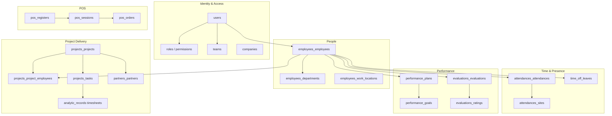
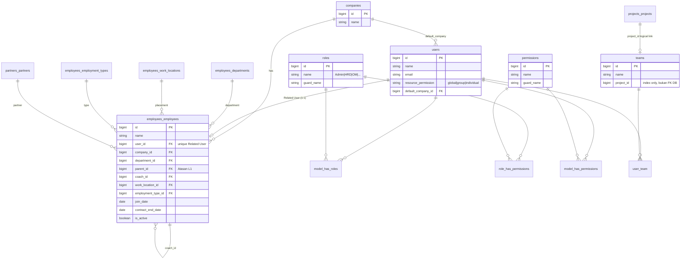
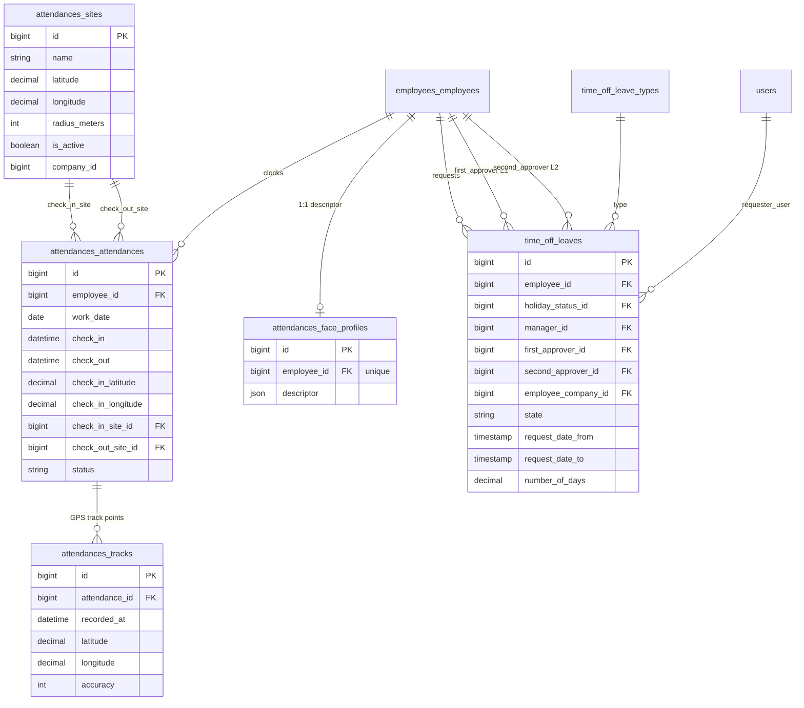
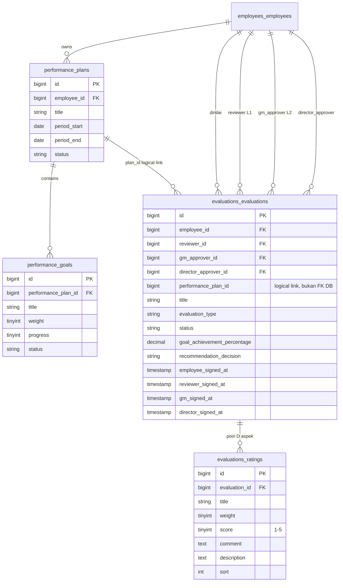
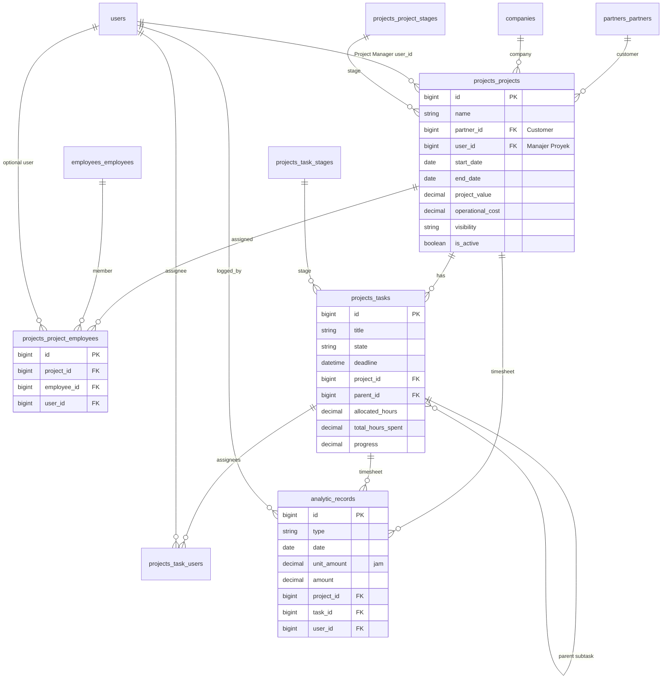
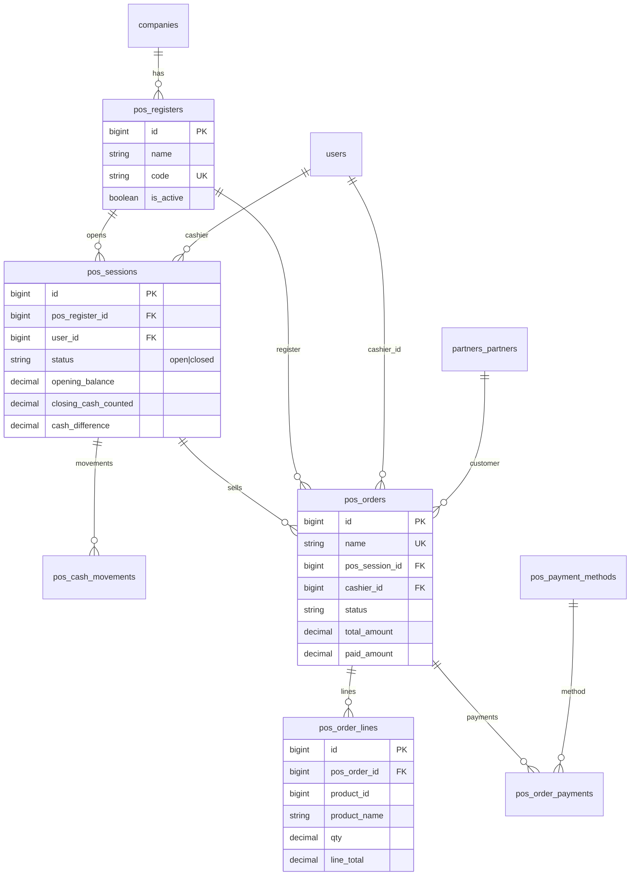
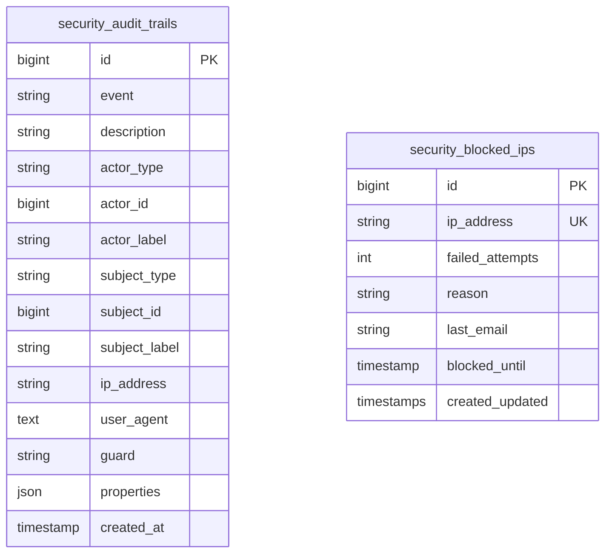

# ERD — auraERP (Opsora)

| Field | Nilai |
| :--- | :--- |
| **Versi** | 1.2 |
| **Tanggal** | 2026-10-19 |
| **Revisi** | Clarifikasi Manajer Proyek (`user_id`) vs pivot Assign Employees |
| **Sumber** | Migrasi plugin `plugins/webkul/*` (bukan dump DB penuh) |
| **Schema detail** | [DATABASE-SCHEMA.md](./DATABASE-SCHEMA.md) |
| **PRD** | [PRD-auraERP.md](./PRD-auraERP.md) |

Dokumen ini menggambarkan **domain operasional Opsora** (Security/RBAC, HR, Absensi, Time Off, Performance/Evaluasi, Proyek, Timesheet, POS). Modul ERP generik (Sales/Purchase/Inventory penuh, Accounting ledger) ada di AureusERP inti dan tidak digambar lengkap di sini.

---

## 1. Peta domain (konteks)

---

## 2. ERD — Identity, RBAC & organisasi

---

## 3. ERD — Absensi & Time Off

---

## 4. ERD — Performance Plans & Evaluasi

---

## 5. ERD — Proyek, penugasan, task & timesheet

**Catatan laporan:**

- **Laporan Ops Mingguan** — query agregat `projects_*` + `analytic_records` + absensi/cuti (tidak ada tabel laporan terpisah).
- **Laporan Mingguan Proyek untuk Klien** — sama; masking diterapkan di layer export (bukan kolom DB).

---

## 6. ERD — POS

---

## 7. ERD — Security audit & blokir IP

*(Morph `actor` / `subject` biasanya menunjuk `users` atau model terkait peristiwa. `teams.project_id` dan `evaluations.performance_plan_id` adalah tautan logis ber-index/kolom, **bukan** foreign key constraint DB.)*

---

## 8. Relasi kunci bisnis (narasi)

| Relasi | Kardinalitas | Makna operasional |
| :--- | :--- | :--- |
| `users` ↔ `employees_employees` | 0..1 / 1 | Related User; wajib untuk login & akses proyek |
| `employees.parent_id` | pohon | Approver L1; L2 = parent-of-parent / dept manager |
| `projects.partner_id` | N:1 | Customer pemilik banyak proyek |
| `projects_project_employees` | N:M | Assign Employees (anggota kerja proyek; unassign = hapus baris pivot) |
| `teams.project_id` / nama Tim ≈ nama Proyek | 0..1 | Sinkron anggota Tim ↔ assign proyek |
| `projects.user_id` | N:1 | **Manajer Proyek** (1 user); set/clear di form proyek, terpisah dari pivot assign |
| `evaluations.reviewer_id` / `gm_approver_id` | N:1 | Tanda tangan L1 / L2 |
| `analytic_records.project_id` + `task_id` | N:1 | Timesheet jam kerja (internal; disembunyikan di laporan klien) |
| `attendances_sites` | 1:N attendance | Geofence clock-in/out |

---

## 9. Di luar cakupan diagram

Tabel AureusERP generik (contoh): `sales_orders`, `purchases_orders`, `inventories_*`, `accounts_account_moves`, `products_products`, `maintenance_equipments`, chatter/activity, settings. Lihat migrasi masing-masing plugin bila diperlukan.

Untuk daftar kolom & FK lengkap domain Opsora, lihat **[DATABASE-SCHEMA.md](./DATABASE-SCHEMA.md)**.
